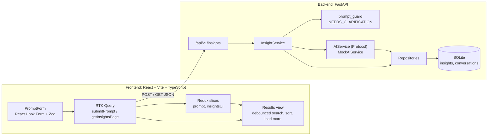

# AI Insights App

This repository contains two applications built using React and Python (FastAPI), respectively.

The React application is a frontend that lets the user type a prompt, pick a language and view the insights returned. The user can search, sort and load more results.

The FastAPI application is a backend that checks the prompt, returns insights from dummy data stored in SQLite, and sends results page by page. No real AI model is used.

## Installation

You need Python 3.11 or newer and Node.js 20.19 or newer.

Install the dependencies for both applications:

    cd ai-insights-app/backend
    python -m venv .venv
    .venv\Scripts\activate          (Mac/Linux: source .venv/bin/activate)
    pip install -r requirements.txt

    cd ../frontend
    npm install

## Running the Application

Backend Application:
To start the backend application, navigate to the `backend` directory, activate the virtual environment and run:

    uvicorn app.main:app --reload

This will start the server at http://localhost:8000/. API docs are at http://localhost:8000/docs. The SQLite database is created and filled with sample data automatically on the first start.

Frontend Application:
To start the frontend application, navigate to the `frontend` directory and run:

    npm run dev

This will start the application at http://localhost:5173/. Once it is running, type a prompt, choose a language and click **Get insights**.

The frontend calls the API at `http://localhost:8000/api/v1` by default. To change it, copy `frontend/.env.example` to `frontend/.env` and edit `VITE_API_URL`.

## Architecture



How the backend handles a request: check the input, check the prompt has enough detail, get insights, save the conversation, then return one page of results.

## Technologies Used

The React application was built using the following technologies:

- React 18, Vite, TypeScript
- Redux Toolkit and RTK Query
- React Hook Form and Zod
- Tailwind CSS

The Python application was built using the following technologies:

- Python, FastAPI, Pydantic
- SQLAlchemy and SQLite

## API

```
POST /api/v1/insights
  body: { "prompt": string, "targetLanguage": "en"|"es"|"fr"|"de", "contextId"?: uuid }

200 SUCCESS
  { "status": "SUCCESS", "contextId": "uuid",
    "data": [Insight, ... max 10],
    "pagination": { "page": 1, "pageSize": 10, "totalItems": 27, "totalPages": 3, "hasMore": true } | null }
  pagination is null when there are no more results than fit on one page (10 by default)

200 NEEDS_CLARIFICATION
  { "status": "NEEDS_CLARIFICATION", "message": "Please provide more details" }

422 (always this shape)
  { "error": "INVALID_PROMPT" | "INVALID_LANGUAGE" | "INVALID_CONTEXT_ID" | "VALIDATION_ERROR",
    "message": "human readable",
    "details": [ { "field": "prompt", "message": "..." } ] }        // details optional

GET /api/v1/insights/{contextId}?page=2&pageSize=10
  -> same SUCCESS shape for that page
  -> 404 { "error": "CONTEXT_NOT_FOUND", "message": "..." } for an unknown contextId
  -> page >= 1, pageSize default 10 (max 50); a page beyond the last returns empty data

GET /health -> { "status": "ok" }

Insight: { id, title, content, category, tags[], language, confidence (0-1), createdAt (ISO) }
```

Unknown routes and unexpected failures use the same `{ error, message }` shape (`NOT_FOUND`, `METHOD_NOT_ALLOWED`, `INTERNAL_ERROR`).

Example:

```bash
curl -X POST http://localhost:8000/api/v1/insights \
  -H "Content-Type: application/json" \
  -d '{"prompt":"How can we reduce shipping costs?","targetLanguage":"en"}'
```
